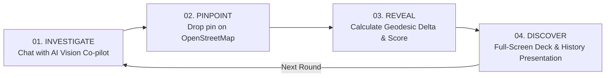

# HeritageGuess 🏛️📍

[](https://nextjs.org/)
[](https://react.dev/)
[](https://tailwindcss.com/)
[](https://leafletjs.com/)
[](https://www.openstreetmap.org/)
[](https://opensource.org/)

> **A high-stakes, gamified historical geography expedition built for digital natives.**  
> Investigate 19th-century archival photographs with an AI field assistant, pinpoint coordinates on full-screen open cartographic maps, and unlock immersive, cinematic heritage presentation decks.

---

## 🎯 Problem & Audience

### The Challenge
Ancient history, classical architecture, and global heritage are often trapped inside dusty textbooks, dry academic monographs, and static museum catalogs. For younger audiences—particularly **Gen Z and digital natives** who thrive on interactivity, visual problem-solving, and game loops—traditional heritage education feels disconnected from modern media consumption.

### The Solution: Gamified Architectural Deduction
**HeritageGuess** reframes cultural preservation as an engaging GeoGuessr-style investigative adventure:
- 🔍 **Active Deduction Over Passive Memorization:** Instead of memorizing dates, players must look closely at monolithic cliff excavations, cusped arches, roofline tiers, weathering patterns, and regional stone types.
- 🤖 **Guardrailed AI Co-Pilot:** An intelligent investigation assistant helps players identify architectural motifs and environmental hints *without ever spoiling the location*.
- 📐 **True Geodesic Precision:** Computes exact Haversine mathematical distances between player guesses and true archaeological coordinates.
- 📽️ **Full-Page Archival Presentations:** Successful guesses unlock rich, keynote-style slide presentations with authentic archival plates, historical background, and cultural narratives.



---

## 🌍 Standing on the Shoulders of Open Source

HeritageGuess is **proudly and unapologetically open-source**. Every piece of the user experience—from the vector tiles and cartographic projections to the client frameworks and archival media—is powered by open protocols, open standards, and community-driven projects.

### 🗺️ Open Cartography & Geospatial
* **[OpenStreetMap (OSM)](https://www.openstreetmap.org/):** The free, community-curated geographic database of the world. No vendor lock-in, no proprietary tracking—just pure, transparent, community-owned cartography.
* **[Leaflet](https://leafletjs.com/) & [React-Leaflet](https://react-leaflet.js.org/):** The legendary open-source JavaScript library for interactive, mobile-friendly maps. Ultra-lightweight, hardware-accelerated, and dependency-conscious.

### 🖼️ Open Cultural Archives
* **[Wikimedia Commons](https://commons.wikimedia.org/):** All photographic plates are sourced from open-access public domain and Creative Commons archival collections—including historical surveys by 19th-century pioneers such as Lala Deen Dayal, John Murray, and royal photographic surveys.

### ⚡ Modern Frontend Engine
* **[Next.js 16](https://nextjs.org/) (App Router & Turbopack):** Modern React framework providing server components, edge API routing, and ultra-fast Rust-based bundling.
* **[React 19](https://react.dev/):** The open-source standard for declarative component architectures.
* **[Tailwind CSS v4](https://tailwindcss.com/) & [PostCSS](https://postcss.org/):** Utility-first styling with a bespoke brutalist/editorial aesthetic, zero runtime bloat, and sub-millisecond compilation.
* **[TypeScript](https://www.typescriptlang.org/):** Static type-safety across all game rounds, API contracts, and geodesic math.

### 🧠 Open-Weights AI Reasoning
* **[Meta Llama 3.3](https://ai.meta.com/llama/):** Open-weights frontier model orchestrated via the [Groq API](https://groq.com/) for lightning-fast inference, configured with strict prompt shielding to prevent location leakage and block non-architectural injection queries.

---

## 📦 Project Dependencies

```json
{
  "dependencies": {
    "next": "16.4.3",
    "react": "19.3.0",
    "react-dom": "19.3.0",
    "leaflet": "^1.9.4",
    "react-leaflet": "^5.0.0",
    "@tailwindcss/postcss": "^4.3.3",
    "@types/leaflet": "^1.9.22"
  },
  "devDependencies": {
    "tailwindcss": "^4",
    "typescript": "^5",
    "eslint": "^9",
    "eslint-config-next": "16.4.3"
  }
}
```

---

## 🚀 Local Setup Guide

Follow these steps to run HeritageGuess locally on your machine.

### 1. Prerequisites
Ensure you have the following installed on your machine:
- **Node.js:** `v18.18.0` or higher (`v20.x` or `v22.x` recommended)
- **Package Manager:** `npm` (comes with Node), `pnpm`, or `yarn`
- **Git**

Verify your versions:
```bash
node -v
npm -v
git --version
```

### 2. Clone the Repository
```bash
git clone https://github.com/your-username/HeritageGuessr.git
cd HeritageGuessr
```

### 3. Install Dependencies
```bash
npm install
```

### 4. Configure Environment Variables
Create a `.env` (or `.env.local`) file in the root directory:

```bash
cp .env.example .env
```

Open `.env` and configure your keys:
```env
# Groq API Key for AI Field Assistant (Free tier available at console.groq.com)
GROQ_API_KEY=your_groq_api_key_here

# Groq model (defaults to llama-3.3-70b-versatile)
GROQ_MODEL=llama-3.3-70b-versatile

# Secret used to cryptographically sign round tokens to prevent cheating
GAME_SESSION_SECRET=replace_with_a_long_random_secret_for_local_dev
```

> **Note:** If you run without a `GROQ_API_KEY`, the app automatically falls back to curated built-in architectural observation tips so the game remains completely playable offline!

### 5. Launch the Development Server
```bash
npm run dev
```

Open [http://localhost:3000](http://localhost:3000) in your browser. The application will start immediately with the Swiss brutalist landing page.

---

## 🛠️ Build & Verification Commands

| Command | Description |
| :--- | :--- |
| `npm run dev` | Compiles CSS via PostCSS and boots the Next.js Turbopack development server |
| `npm run build` | Compiles production assets and generates static pages for all routes |
| `npm run start` | Launches the production server on `localhost:3000` |
| `npm run lint` | Runs ESLint and Next.js static code analyzers |

---

## 🏛️ Project Architecture & Directory Tour

```
HeritageGuessr/
├── app/
│   ├── api/
│   │   ├── game/start/         # Cryptographically signed round generation
│   │   ├── game/submit/        # Geodesic scoring & answer verification
│   │   ├── investigate/        # Guardrailed Groq vision assistant with prompt shields
│   │   └── interpreter/        # Archival cultural narrative generator
│   ├── components/
│   │   ├── GameStore.tsx       # Root-level reactive game state provider
│   │   ├── GuessMap.tsx        # Isolated Leaflet + OpenStreetMap canvas
│   │   ├── Investigation.tsx   # Clue discovery & photo analysis UI
│   │   ├── RevealStage.tsx     # Presentation deck wrapper & lower telemetry HUD
│   │   └── StoryPresentation.tsx # Full-page Keynote-style architectural slides
│   ├── globals.src.css         # Source CSS design system (brutalist, boxy, minimal)
│   ├── globals.css             # Compiled Tailwind utility bundle
│   ├── layout.tsx              # Root HTML, Google Fonts (Oswald, Space Mono, Inter)
│   └── page.tsx                # Boxy, editorial minimalist landing page
├── images/
│   └── data.json               # Curated historical dataset with archival Wikimedia plates
├── public/
│   └── leaflet/                # Self-hosted Leaflet styles and markers (zero external CDN crash)
├── scripts/
│   └── compile-css.mjs         # PostCSS build script compiling Tailwind v4 utilities
├── lib/
│   ├── game-session.ts         # HMAC token signing preventing client inspection cheat
│   ├── scoring.ts              # Mathematical Haversine formula & exponential score decay
│   └── types.ts                # TypeScript interfaces for coordinates, locations & slides
└── next.config.ts              # Next.js 16 partial prefetching & optimization config
```

---

## 🧮 Mathematical Scoring Model

Distance calculation is performed using the **Haversine Formula**, calculating the great-circle distance between the user's pin $(\phi_1, \lambda_1)$ and the monument's true coordinates $(\phi_2, \lambda_2)$:

$$d = 2R \arcsin \left( \sqrt{\sin^2\left(\frac{\Delta\phi}{2}\right) + \cos(\phi_1)\cos(\phi_2)\sin^2\left(\frac{\Delta\lambda}{2}\right)} \right)$$

where $R = 6,371\text{ km}$.

Points are awarded exponentially:
* **Pinpoint Accuracy ($\le 25\text{ km}$):** 5,000 maximum points.
* **Proximity Falloff:** Drops smoothly over distance using exponential decay:

$$\text{Score} = \max\left(0, \left\lfloor 5000 \cdot e^{-\frac{d}{2000}} \right\rfloor\right)$$

---

## 🛡️ Anti-Cheat & Security Design

1. **Zero Location Leaks:** The monument's name, coordinates, and city are **never sent to the client** during the investigation or guess phases.
2. **HMAC Signed Round Tokens:** The client only receives an opaque cryptographically signed token (`id.hmac_signature`). Tampering with the token invalidates the session.
3. **AI Injection Defense:** The Groq assistant strictly filters out attempts to execute code (`print hello world in python`), request coordinates, or prompt-inject the hidden location name. Any accidental mention of the target location is automatically scrubbed by a server-side regex redaction filter.

---

## 🤝 Contributing

Contributions are warmly welcome! Whether you are:
- Adding new open-source historical plates and architectural slide data from your region.
- Improving accessibility or translations.
- Enhancing Leaflet map rendering or mobile controls.

1. Fork the repo.
2. Create your feature branch (`git checkout -b feature/ancient-civilization`).
3. Commit your changes (`git commit -m 'Add Nalanda University archival plate'`).
4. Push to the branch (`git push origin feature/ancient-civilization`).
5. Open a Pull Request.

---

## 📄 License

This project is licensed under the **MIT License**.  
All archival images remain under their respective **Public Domain** or **Creative Commons** licenses hosted on Wikimedia Commons. Map data &copy; [OpenStreetMap](https://www.openstreetmap.org/copyright) contributors.
